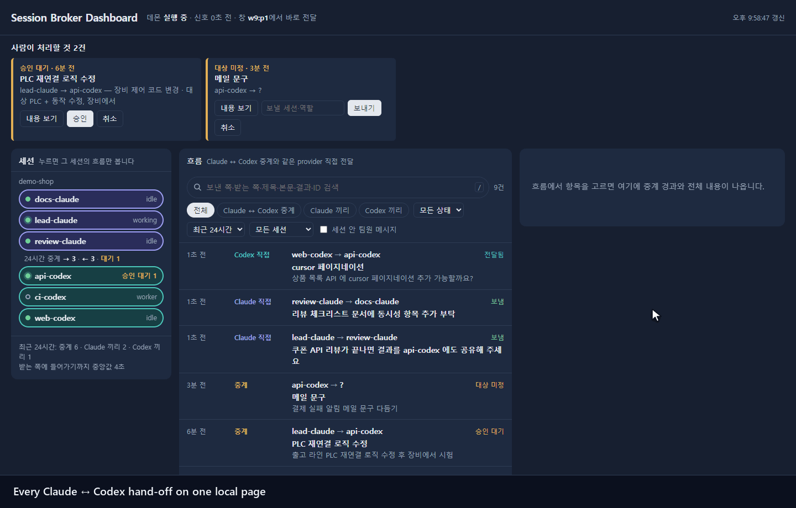
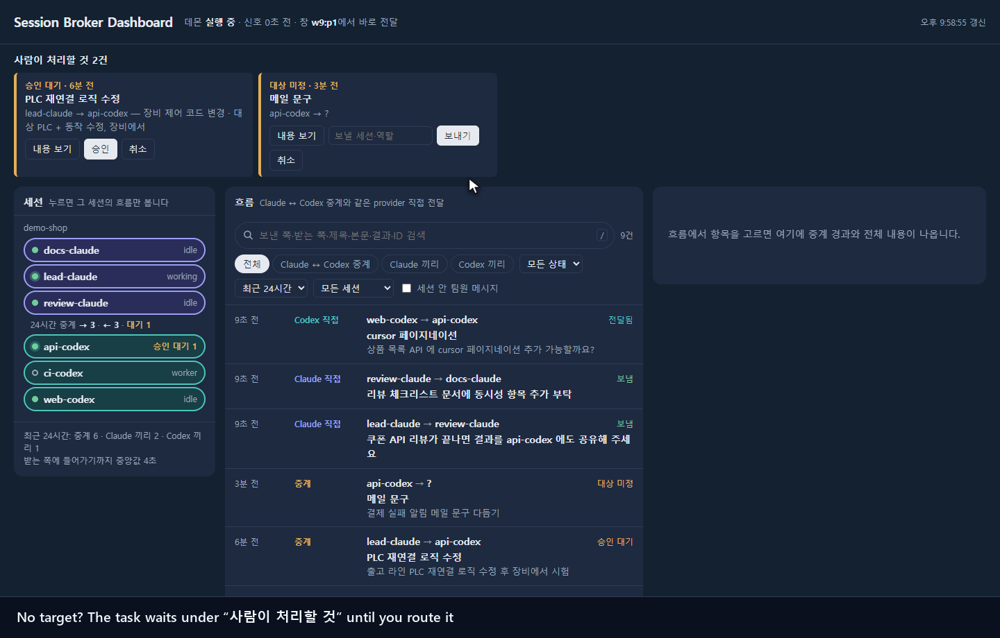
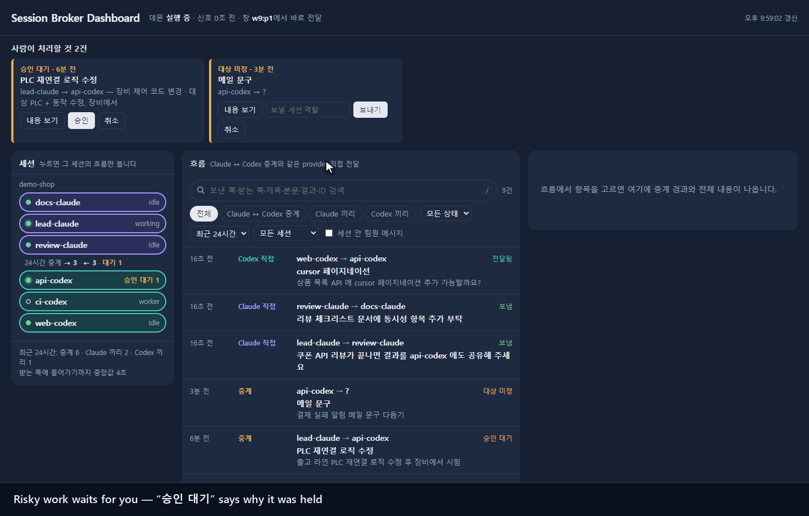
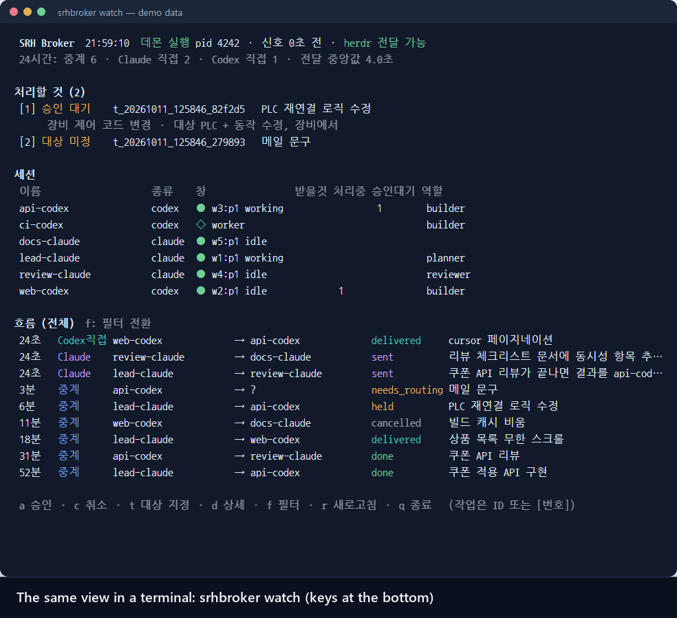
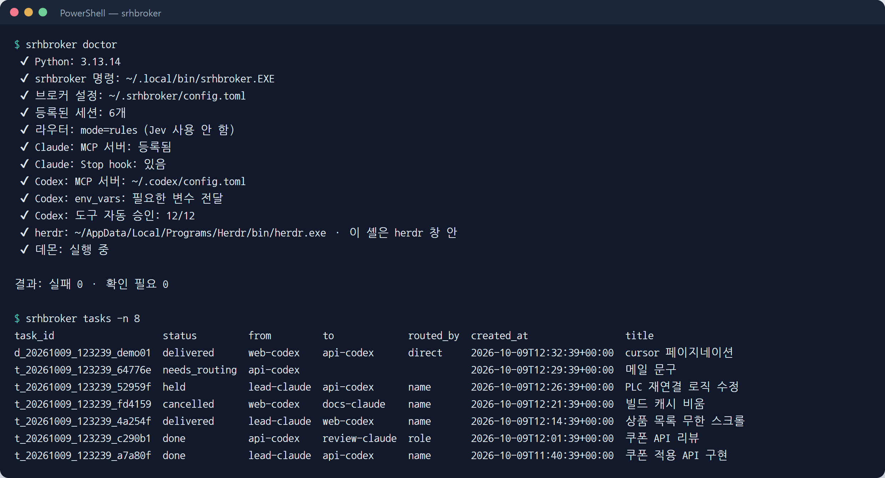

<div align="center">

# SRH Session Broker

**Let Claude Code and Codex sessions hand work to each other by name. A [herdr](https://herdr.dev) plugin.**

[](LICENSE)
[](https://herdr.dev/plugins/)


[](https://srhsol.com)

English · [한국어](README.ko.md)

</div>



<sub>Everything on screen is demo data from `srhbroker demo`. The dashboard and CLI messages are in Korean for now. The captions under each GIF explain the steps.</sub>

When you run several Claude Code and Codex panes side by side, one pane keeps needing another: "ask the Codex pane to implement this", "have the reviewer look at it", "tell the web pane the build cache is cleared". SRH Session Broker lets each session call the others **by the name you gave it with `/rename`**. Messages are **typed straight into the receiving pane**, and replies **come back to the pane that asked**. Risky work waits for your approval. You can watch all of it in a terminal or web dashboard.

- **Call sessions by name or role.** A pane renamed `web-codex` is `web-codex`. Ask for `reviewer` and the broker picks a session with that role.
- **Delivered into the pane.** Inside herdr, the message is typed into the receiving session even while it is working. The reply is typed back into the sender.
- **Relays only between Claude and Codex.** Claude ↔ Claude uses Claude's own `SendMessage`. Separate Codex panes reach each other through herdr directly.
- **Safety gate.** A request that names hardware *and* a control action is forced read-only. Changes to device-control code and irreversible actions (push, deploy, delete, data migration) wait for a human. Things you asked for yourself, and plain notices, are not asked again.
- **Lightweight notices.** A notice that needs no action is sent without approval. If the receiving pane is closed, it is dropped instead of queued.
- **Dashboards.** `srhbroker watch` in a terminal, and a local web dashboard showing each relay step: sent → routed → safety check → approval → delivered → reply.
- **Optional AI router.** Leave the target out and [TypeSafe](https://typesafe.ai) Jev picks a role. Without a key, routing uses names, roles and rules.

## Install as a herdr plugin

| You need | Notes |
|---|---|
| [herdr](https://herdr.dev) 0.9.0 or later | |
| [uv](https://docs.astral.sh/uv/) | The plugin uses it to install the `srhbroker` CLI. macOS `brew install uv`, Windows `winget install astral-sh.uv` |
| [Claude Code](https://docs.claude.com/en/docs/claude-code) and/or [Codex CLI](https://github.com/openai/codex) | The broker relays between the two |
| TypeSafe API key (optional) | For the AI router (`TYPESAFE_API_KEY`) |

Python 3.11+ is fetched by uv if your system Python is older.

```sh
herdr plugin install SRHSolution/srh-session-broker
```

herdr shows the commands the plugin will run and asks you to confirm. The build step then:

- installs the `srhbroker` CLI with `uv tool install`, including the optional AI router;
- leaves an existing install alone if it is the same version or newer;
- updates an older install with its own `srhbroker update`, so a source checkout or pipx install keeps its install method;
- creates `~/.srhbroker/config.toml` if it is missing.

> [!NOTE]
> **Windows:** a running `srhbroker` process locks its own install, so updating an older version from the plugin build stops and lists what is running. These are the engine, the dashboard, and the MCP server inside each open session. Run `srhbroker update --stop-all`, then install the plugin again.
>
> **PATH:** if the build says `~/.local/bin` is not on PATH, run `uv tool update-shell` and restart herdr so the plugin can find `srhbroker`.

### What the plugin adds

herdr has no menu for plugin actions yet. Run an action from any herdr pane with `herdr plugin action invoke srhbroker.<action>`, or [bind it to a key](#bind-actions-to-keys).

| Action | What it does |
|---|---|
| `start-engine` | Starts the [engine](#running-the-engine) in its own tab named `srhbroker`. If the engine is already running, it only tells you so. |
| `dashboard` | Opens the web dashboard in your browser, starting it in a `broker web` tab first if needed. |
| `watch` | Opens the terminal dashboard (`srhbroker watch`) in a split next to the current pane. |
| `status` | Shows the engine, herdr, the pane of each session, and waiting work in a popup. |
| `doctor` | Runs `srhbroker doctor` in a popup: what is missing and the command that fixes it. |
| `connect-claude` | `srhbroker setup claude --apply`: adds the user-scope MCP server and hooks. |
| `connect-codex` | `srhbroker setup codex --apply`: adds the MCP server, forwarded environment variables and tool auto-approval to `~/.codex/config.toml`. |

Popups close with Enter. The plugin also starts the engine whenever the herdr server starts ([details](#running-the-engine)).

### Bind actions to keys

Add bindings to herdr's `config.toml` (`~/.config/herdr/config.toml`, on Windows `%APPDATA%\herdr\config.toml`), then reload it with `prefix+shift+r` or `herdr server reload-config`. The prefix is `ctrl+b` by default. No default binding uses `prefix+alt`, but check `prefix+?` for your own.

```toml
[[keys.command]]
key = "prefix+alt+e"
type = "plugin_action"
command = "srhbroker.start-engine"
description = "broker: start engine"

[[keys.command]]
key = "prefix+alt+d"
type = "plugin_action"
command = "srhbroker.dashboard"
description = "broker: web dashboard"

[[keys.command]]
key = "prefix+alt+w"
type = "plugin_action"
command = "srhbroker.watch"
description = "broker: terminal dashboard"

[[keys.command]]
key = "prefix+alt+s"
type = "plugin_action"
command = "srhbroker.status"
description = "broker: status"
```

### First run

Run these in any herdr pane:

1. Connect the agents you use. Both commands back up the file they change (`*.bak-<time>`) and only add what is missing.

   ```sh
   herdr plugin action invoke srhbroker.connect-claude
   herdr plugin action invoke srhbroker.connect-codex
   ```

   Already-open Claude panes pick up the MCP server after `/mcp` → reconnect `srhbroker`. Codex panes need to be reopened.
2. Start the engine. herdr runs the plugin's startup step only when its server starts, so right after installing, the engine is not running yet.

   ```sh
   herdr plugin action invoke srhbroker.start-engine
   ```

3. Check the setup with `herdr plugin action invoke srhbroker.doctor` and fix anything marked ✖.
4. Name and register each session. In each Claude Code or Codex pane:

   ```text
   /rename web-codex
   register this session with the broker
   ```

   The session calls `register()` and is registered under its `/rename` name. If an earlier, now-closed session had the same name, the new one inherits the name and any messages waiting for it.
5. Try it:

   ```text
   (in a Claude pane)  Ask api-codex to implement the cart coupon API, then have the reviewer check it
   (in a Codex pane)   Tell lead-claude the build cache is cleared
   ```

Sessions understand these requests in any language. The examples are just phrasing.

## Running the engine

The engine is `srhbroker daemon`. It is the same program with or without the plugin, and one runs per machine. It:

- runs tasks for `worker` sessions;
- types in tasks and replies that were waiting for a closed pane, once that pane opens (it checks every second);
- expires work left in held, needs_routing or queued for longer than `[broker] stale_after_s` (24 hours by default);
- checks for new releases.

A message to a pane that is already open is typed in by the sending session itself, so it arrives even while the engine is down. Anything that has to wait needs the engine.

| | With the plugin | Without the plugin |
|---|---|---|
| Start | Automatic when the herdr server starts. To start it now: `herdr plugin action invoke srhbroker.start-engine` | Run `srhbroker daemon` in a herdr pane of its own, such as a new tab |
| Runs in | A tab named `srhbroker` | The pane you started it in |
| Stop | Close the tab, or press `ctrl+c` in it | `ctrl+c` |
| After `srhbroker update` | Reopened in a new `srhbroker` tab with the new code | Restarted in the same pane with the new code |
| Check | `srhbroker status` | `srhbroker status` |

- **When the herdr server starts.** The herdr server keeps running after you close the terminal. It starts again with the first `herdr` after a reboot or after `herdr server stop`. If the engine is already running then, no tab is opened. To turn the automatic start off, set this in `~/.srhbroker/config.toml`:

  ```toml
  [plugin]
  autostart_engine = false
  ```

- **Run it inside herdr.** Outside herdr the engine still runs workers and expires stale work, but it cannot type into panes. Waiting messages then arrive through `inbox` and the Claude Stop hook. `srhbroker status` shows `herdr 전달: 불가` (*herdr delivery: unavailable*) in that case.
- **One engine.** A second `srhbroker daemon` exits with `디스패처가 이미 실행 중입니다` (*already running*), and a second engine tab closes itself. With the plugin installed you can still run `srhbroker daemon` yourself; herdr then sees it running and opens no tab.
- `srhbroker plugin start-engine` is what the action runs. You can type it in a herdr pane instead of the `herdr plugin action invoke` command.

## Using it

### From inside a session

| You want to | Say something like | What the broker does |
|---|---|---|
| Hand work to the other provider | "Ask api-codex to implement the coupon API" | `send` → typed into the receiving pane → the reply comes back to you |
| Hand work to a role | "Get the reviewer to check this change" | Picks a `reviewer` session and sends the request read-only |
| Send a notice | "Tell web-codex the build cache is cleared" | `kind=message`: no approval, dropped if that pane is closed |
| Check what you sent | "Show what I sent that isn't finished" | `recent(mine=true, active=true)` |
| Cancel | "Cancel what I just sent" | `cancel`. If it was already delivered, the receiving pane is told to stop. |
| Read your inbox | "Check my broker inbox" | `inbox(mark=false)` |
| Check your registration | "broker whoami" | Reports a `hint` if the registered name and the `/rename` name differ |
| Rename | (after `/rename`) "Rename my broker registration too" | `rename(new_name)`. The session ID, roles and aliases stay, the old name becomes an alias, and pending work follows the new name. |

### Web dashboard

Run `srhbroker dashboard --open`, or the plugin action `herdr plugin action invoke srhbroker.dashboard`.

**Route a task that has no target.** It waits under "사람이 처리할 것" (*needs you*) until you pick a session or role.



**Approve held work.** "승인 대기" (*awaiting approval*) shows why the task was held. Approving delivers it and logs who approved it.



- **Layout.** On wide screens there are three columns. The left column is the session switchboard: sessions grouped by project with pane state, waiting work and 24-hour counts; click one to filter. The middle column lists flows with time, route, sender → receiver, status, title and a three-line preview. The right column shows the detail: relay timeline, full body, result and the Jev verdict. On narrow screens the detail opens as an overlay.
- **Search and filters.** Press `/` to search senders, receivers, titles, bodies, results and IDs across the whole history. You can also filter by route, status, period and session, and choose whether to include agent-team messages inside a session. Filters are remembered in the browser.
- **Security.** The dashboard listens on `127.0.0.1` only and needs the token printed at start. Open the printed `?t=…` address once and that browser remembers it for 30 days through an HttpOnly, SameSite=Strict cookie. Approve, cancel and route are POST requests checked against the token, Origin and Host, which blocks CSRF and DNS rebinding. Approvals are logged with `via=dashboard` or `via=watch`.
- **Token.** It is stored in `~/.srhbroker/dashboard.token`, so the address survives restarts. `--new-token` replaces it and invalidates remembered cookies.

### Terminal dashboard

Run `srhbroker watch`, or the plugin action `srhbroker.watch` to open it in a split. Keys: `a` approve · `c` cancel · `t` route · `d` detail · `f` flow filter · `r` refresh · `q` quit. Pick a task by its ID or its `[number]`.



### Command line

| Command | Use |
|---|---|
| `srhbroker status` | Engine, herdr, each session's pane, waiting work (read-only) |
| `srhbroker doctor` | Install and connection check, with fixes |
| `srhbroker tasks [--from NAME] [--active]` · `show <id>` | Task list; result and routing reasons |
| `srhbroker send "<body>" --to <name\|role> [--wait]` | Send as a person (`from=user`) |
| `srhbroker approve <id>` · `cancel <id>` · `route <id> <target>` | Approve, cancel, route |
| `srhbroker discover` · `register --session <ID>` · `sessions` | Find sessions, register, list |
| `srhbroker rename <current> <new>` | Rename a registration. Given a deleted old name, the new session inherits its records. |
| `srhbroker reconnect <name> [--session <ID>]` | Keep the name and point it at another session ID. Without `--session`, the most recent session with that `/rename` name is used, for example after switching accounts. |
| `srhbroker watch` · `dashboard [--open] [--port]` | Terminal and web dashboards |
| `srhbroker daemon` | Run the [engine](#running-the-engine) in the current pane |
| `srhbroker setup claude\|codex [--apply]` · `init` · `demo` | Connect, initialize, demo data |
| `srhbroker update [--check] [--to vX.Y.Z] [--stop-all]` · `--version` | Update from the repository's release tags |



## How it works

### Concepts

| | |
|---|---|
| **Session name** | Globally unique. The provider comes from the registration. Existing sessions use their `/rename` name in lowercase with `-`, so `Project Lead` becomes `project-lead`. The original spelling is accepted as an address. `codex:builder` also works. |
| **Alias** | A short, globally unique name (`b`, `rev`) |
| **Role** | What the router picks (`planner`, `builder`, `reviewer`). Several sessions can share one. |
| **Mode** | `interactive`: a pane a person watches, receiving through herdr or the Stop hook. `worker`: run headless by the engine. |
| **Contract** | `task` (needs a reply), `message` (notice only), `reply` (result) |

### How the target is resolved

1. `to`, or a leading `@name` in the body, exactly matches a session name or alias. If it is the same provider, the sender is told to use its native tool. A different provider is relayed, and Jev only judges safety.
2. It matches a role. Among sessions of the *other* provider with that role, an idle one is preferred, then the role's preferred provider, then a worker.
3. Anything else (no target, a provider such as `codex`, or a free-text hint) goes through config rules (regex), then Jev picks a role, then the broker picks a session.
4. If confidence is too low, the task stays `needs_routing` with suggestions until a person routes it.

Roles, rules, Jev candidates and manual routes only target **the other provider**. A request from the CLI (`from=user`) can go to either. Use `--from <session>` to send on behalf of a session.

### Same-provider messages

- **Claude → Claude:** `ListAgents` → `SendMessage`. The broker never relays these. A Claude PostToolUse hook only records them so they show up in the dashboards.
- **Codex → Codex:** Codex collaboration tools only reach sub-agents that session spawned. So `send(to='<name>')` has the broker type the message into the other Codex pane through herdr. It waits if the pane is closed or showing an approval prompt; notices are dropped instead. These go through a direct-delivery queue (`direct_id: d_…`, no `task_id`) with no Jev, safety check or reply tracking. The receiver answers with its own `send`. `cancel(d_…)` cancels an undelivered one, and they expire after 24 hours.
- A `send` to the same provider by mistake returns `native_required` with `delivered: false` and the real targets. The calling session must deliver it with its native tool. It must never route around this through the broker or herdr.

### Router modes (`[router] mode`)

| Mode | Behavior |
|---|---|
| `rules` | Names, roles and rules only. Jev is never called. |
| `shadow` (default) | Rules decide. Jev's verdict is only recorded; compare them with `srhbroker routes`. |
| `jev` | Jev decides when no rule matches. Low confidence asks a person. |

Without `TYPESAFE_API_KEY`, or if Jev fails, routing keeps working with names, roles, rules and people.

### Safety gate

- **Hardware target + control action in the same sentence** forces `read-only` (`[router.hw_rules]`).
  - Targets include X-ray generators and tubes, kV/mA/exposure, shock wave, PLC/MC Protocol/pulse, C-arm and patient tables, motors and robot arms, serial/COM, firmware, interlock/E-stop, detector SDK gain, dose, and control-code paths. Add project-specific class or SDK names under `[router.hw_rules] extra_targets`.
  - Actions include control, drive, fire, expose, move, register write, set or change parameters, apply, flash firmware, reboot, calibrate, bench test, implement and modify.
  - Imaging words alone (X-ray, DICOM, PACS) only add a small risk and do not force read-only.
- **Held for approval:** only *write* work that the sending session decided on by itself, and only when it is one of these:
  - a device-control code change. This means the hardware rule matched and Jev judges that the request makes the change happen (`hw_hold_threshold`). Approved work runs with the requested permissions.
  - an irreversible external action or a critical code change (Jev `needs_human` ≥ threshold).
- **Never held:**
  - notices and replies to interactive panes;
  - read-only requests;
  - work the user asked for directly, sent with `send(user_directed=true, user_request='<the user's words>')` and logged verbatim;
  - work sent by a person from the CLI.
- Held work is approved by a person in the CLI (`srhbroker approve <id>`), the terminal dashboard, or the web dashboard. The MCP `approve` tool is off unless you set `[broker] allow_mcp_approve = true`.
- A session's `sandbox` caps its permissions. A reviewer registered `read-only` never runs anything with write access.

### Delivery through herdr

- The broker finds a pane through `herdr agent list`: `agent_session.value` is the registered session ID. Pane IDs change when panes move, so they are never stored.
- herdr pairs a pane with whichever Claude process last reported in it. A background or nested session started from that pane can take the pairing. The broker therefore checks that the agent kind and folder match, and that the pane title (Claude uses the session name) is not another registered session.
- If the pairing is missing or wrong, it uses the single pane whose title is this session's name. Failing that, it reports `pane-mismatch` and the session receives the message through the Stop hook instead.
- **Busy panes still receive** (`push_while_working`, on by default). Claude folds the message into its current turn, and Codex steers it in. Panes showing an approval or question prompt are not typed into. A background `srhbroker deliver <name> --wait` waits for the prompt to clear.
- **Notices are not queued.** A `message` to a closed pane is dropped (`delivery: dropped`). Tasks and replies wait until the pane opens. Set `[herdr] drop_notices_when_closed = false` to queue notices too.
- At most 30 messages per session every 10 minutes (`max_push_per_10min`) to stop ping-pong. Bodies over 6,000 characters are shortened, with a pointer to `status(task_id)`.
- Outside herdr (`HERDR_ENV` unset), nothing is typed into panes. Messages arrive through the inbox and the Claude Stop hook.

### What leaves your machine

Only the AI router talks to an outside service, and only when a key is set. It sends the task title, the start of the body (`max_body_chars`, default 1,500), the sender name and role descriptions. Set `send_body = false` to send titles only. Everything else stays in `~/.srhbroker` (SQLite).

## Configuration

`~/.srhbroker/config.toml` (or `$SRHBROKER_HOME/config.toml`). `srhbroker init` writes a commented example. The settings you are most likely to change:

| Setting | Default | Meaning |
|---|---|---|
| `[plugin] autostart_engine` | `true` | Start the engine tab when the herdr server starts |
| `[router] mode` | `shadow` | `rules` · `shadow` · `jev` |
| `[[roles]]` | | `name`, `description`, `preferred_provider` |
| `[router.hw_rules] extra_targets` | `[]` | Project-specific hardware names for the safety gate |
| `[herdr] push_while_working` | `true` | Type into panes that are busy |
| `[herdr] drop_notices_when_closed` | `true` | Drop notices to closed panes |
| `[broker] stale_after_s` | `86400` | Expire work stuck in held, needs_routing or queued |
| `[monitor] dashboard_port` | `8765` | Web dashboard port |
| `[update] check` | `true` | Check for new releases (shown in watch, the dashboard and doctor) |

Put `TYPESAFE_API_KEY=...` in your environment or in `~/.srhbroker/.env` to enable the AI router.

## Updating

```sh
srhbroker update --check        # is there a newer release tag?
srhbroker update                # install it
srhbroker update --to v0.5.2    # a specific version, including going back
```

- The install method is detected. uv tool and pipx reinstall from the tag, and a source checkout runs `git pull --ff-only`.
- Settings that new versions need are applied afterwards, such as Codex auto-approval for new tools.
- The engine is restarted with the new code: in its plugin tab, or in the pane where you started `srhbroker daemon`. This is skipped while a worker task is running.
- To refresh the plugin's own action list, run `herdr plugin install SRHSolution/srh-session-broker` again.
- **Windows:** running srhbroker processes lock the install. `update` lists them and stops. `--stop-all` ends them and finishes the install in a separate process; the log is in `~/.srhbroker/update.log`.
- Afterwards, reconnect `srhbroker` in open Claude panes with `/mcp`, and reopen Codex panes.

## Without the plugin

Install the CLI yourself and start the [engine](#running-the-engine) by hand. herdr is optional: without it, messages arrive through the inbox and the Claude Stop hook instead of being typed into panes.

```sh
uv tool install "srh-session-broker[jev] @ git+https://github.com/SRHSolution/srh-session-broker"
# or: pipx install "srh-session-broker[jev] @ git+https://github.com/SRHSolution/srh-session-broker"

srhbroker init
srhbroker setup claude --apply
srhbroker setup codex --apply
srhbroker doctor
srhbroker daemon        # the engine: keep it running in a herdr pane of its own
```

To try the dashboards without any sessions, run `srhbroker demo`. It builds demo data in a temporary folder and prints how to point `watch` and `dashboard` at it. Your real data is not touched.

## Troubleshooting

**A session knows itself by another name.** Ask it for "broker whoami". A `hint` means the registered name differs from the `/rename` name. Say "register this session with the broker again" and `register()` moves the registration to the `/rename` name. If a register call fails, the session reports the error instead of inventing a name or working around it.

**Same name, different session ID** (you switched accounts, or reopened and got a new session). Run `srhbroker reconnect <name>` to point the name at the most recent session with that `/rename` name. Roles, aliases and waiting messages carry over.

**`/resume` inside a Claude pane.** Claude has two IDs. One is the process ID (`CLAUDE_CODE_SESSION_ID`); the other is the conversation ID (the transcript name, used by `claude --resume <ID>` and hooks). After an in-pane `/resume` they differ. The broker registers conversation IDs and reads the current one from the transcript, so just reconnect `srhbroker` with `/mcp` in that pane.

**`pane-mismatch`.** Another session took the pane's herdr pairing, and no pane titled with this session's name was found. `srhbroker status` shows who owns the paired pane. Reopen the session in its own pane, or let it receive through the Stop hook.

**The engine is not running** (`srhbroker status` says `데몬: 실행 중 아님`). Start it as shown in [Running the engine](#running-the-engine). If it fails to start, the `srhbroker` tab stays open with the error until you press Enter.

**Plugin actions do nothing.** Check the plugin log with `herdr plugin log list --plugin srhbroker`. The usual cause is `srhbroker` missing from herdr's PATH: run `uv tool update-shell`, then restart herdr.

**Codex hooks on Windows.** Codex runs hook commands through PowerShell. A command that starts with a quoted path fails with `hook exited with code 1`, so use a path without spaces and without quotes.

## MCP tools

| Tool | Use |
|---|---|
| `send(body, to?, title?, kind?, acceptance?, reply_schema?, sandbox?, deadline_s?, resume_on_reply?, user_directed?, user_request?)` | Send work or a notice to the other provider. Same provider returns `native_required`. |
| `wait(task_id, timeout_s)` | Wait for completion. `waiting=true` means call again. |
| `status(task_id)` | State, result, routing reasons |
| `recent(mine?, active?, status?)` | Recent work. `recent(mine=true, active=true)` = my unfinished work. |
| `inbox(me?, mark?)` | Received work and notices, new replies to my work |
| `cancel(task_id)` | Cancel work I sent. If it was delivered, the receiver is told to stop. |
| `reply(task_id, result, status)` | Reply to work I received |
| `route(task_id, to)` | Route a `needs_routing` task |
| `rename(new_name, old_name?)` | Rename this session's registration |
| `register` · `sessions` · `whoami` | Registration |

A worker's final answer becomes its reply automatically. If it calls `reply` during the turn, that reply wins.

## Tested on

| | |
|---|---|
| Windows 11 | Daily use. 236 tests pass. The herdr plugin was checked on herdr 0.9.1: link, actions, popup output, engine tab, update restart. |
| macOS 26.6 (Apple Silicon) | Install → `setup --apply` → `doctor` → demo and web dashboard, plus the engine running a real `codex exec` worker. The herdr plugin has not been checked on macOS yet. |
| Linux | Expected to work on the same POSIX paths, but not yet tested. Please open an issue if something breaks. |
| Claude Code 2.x · codex-cli 0.159–0.160 | MCP environment, session IDs, `-p --session-id` / `--resume`, `exec resume`, Stop hook format |

## Development

```sh
git clone https://github.com/SRHSolution/srh-session-broker
cd srh-session-broker
uv venv && uv pip install -e ".[dev]"
uv run pytest -q
herdr plugin link .          # use this checkout as the herdr plugin (link skips the build step)
```

- Layout: `models` · `native` (Claude/Codex transcripts) → `store` (SQLite, CAS transitions) → `router` (G1–G3) → `service` (Broker, G4) → `dispatcher` (G5) / `mcp_server` / `cli`, plus `plugin` (herdr glue), `onboard` (setup, doctor, demo), `monitor`, `watch` and `dashboard`.
- Provider differences live only in `adapters/`. CLI flags are templates in `config.DEFAULTS`.
- Data sent to Jev is built in one place, `router._state`.
- Screens are rendered from demo data. Install `uv pip install -e ".[screenshots]"`, then run `python scripts/render_screenshots.py` for the PNGs and `python scripts/render_gifs.py` for the GIFs. Both need Chrome and Pillow.

Issues and pull requests are welcome. With a bug report, please include `srhbroker doctor` output and your OS, Claude Code and Codex versions.

## Changelog

See [CHANGELOG.md](CHANGELOG.md) (in Korean). Check your version with `srhbroker --version`.

## License

[MIT](LICENSE) © 2026 [SRH Solutions](https://srhsol.com). Commercial use, modification and redistribution are all allowed.

## About SRH Solutions

[SRH Solutions](https://srhsol.com) builds medical imaging software, device and robot control, and B2B SaaS. We built this broker while developing device-integration software with many AI coding sessions at once, and opened it up.

- Website: https://srhsol.com
- GitHub: [@SRHSolution](https://github.com/SRHSolution)
